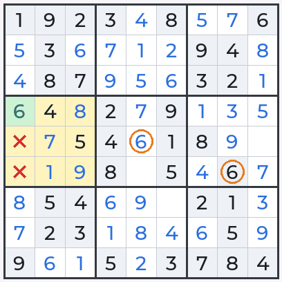

<!-- Written by tools/walkthrough.py dutch-flatmates: edit the script, not this page. -->
# Dutch Flatmates, step 40: the 6 in box 4

**Step 40 of 45** · [← Step 39](step-39.md) · [All steps](../dutch-flatmates.md#the-whole-puzzle-step-by-step) · [Step 41 →](step-41.md)

Box 4 needs a 6. r5c1: row 5 has one (r5c5). r6c1: row 6 has one (r6c8). Only **r4c1** is left: **r4c1 = 6**.

**Step 40 of 45** · [← Step 39](step-39.md) · [All steps](../dutch-flatmates.md#the-whole-puzzle-step-by-step) · [Step 41 →](step-41.md)
