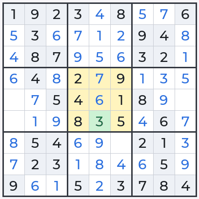

<!-- Written by tools/walkthrough.py dutch-flatmates: edit the script, not this page. -->
# Dutch Flatmates, step 41: the 3 in box 5

**Step 41 of 45** · [← Step 40](step-40.md) · [All steps](../dutch-flatmates.md#the-whole-puzzle-step-by-step) · [Step 42 →](step-42.md)

Box 5 needs a 3, and r6c5 is its last empty cell: **r6c5 = 3**.

**Step 41 of 45** · [← Step 40](step-40.md) · [All steps](../dutch-flatmates.md#the-whole-puzzle-step-by-step) · [Step 42 →](step-42.md)
