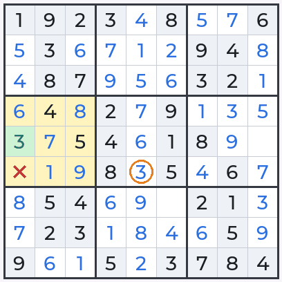

<!-- Written by tools/walkthrough.py dutch-flatmates: edit the script, not this page. -->
# Dutch Flatmates, step 42: the 3 in box 4

**Step 42 of 45** · [← Step 41](step-41.md) · [All steps](../dutch-flatmates.md#the-whole-puzzle-step-by-step) · [Step 43 →](step-43.md)

Box 4 needs a 3. r6c1: row 6 has one (r6c5). Only **r5c1** is left: **r5c1 = 3**.

**Step 42 of 45** · [← Step 41](step-41.md) · [All steps](../dutch-flatmates.md#the-whole-puzzle-step-by-step) · [Step 43 →](step-43.md)
