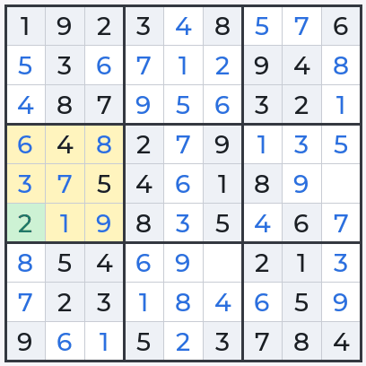

<!-- Written by tools/walkthrough.py dutch-flatmates: edit the script, not this page. -->
# Dutch Flatmates, step 43: the 2 in box 4

**Step 43 of 45** · [← Step 42](step-42.md) · [All steps](../dutch-flatmates.md#the-whole-puzzle-step-by-step) · [Step 44 →](step-44.md)

Box 4 needs a 2, and r6c1 is its last empty cell: **r6c1 = 2**.

**Step 43 of 45** · [← Step 42](step-42.md) · [All steps](../dutch-flatmates.md#the-whole-puzzle-step-by-step) · [Step 44 →](step-44.md)
