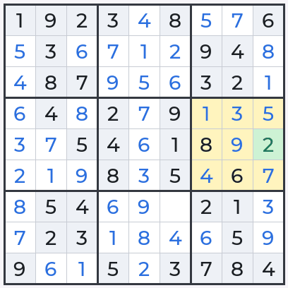

<!-- Written by tools/walkthrough.py dutch-flatmates: edit the script, not this page. -->
# Dutch Flatmates, step 44: the 2 in box 6

**Step 44 of 45** · [← Step 43](step-43.md) · [All steps](../dutch-flatmates.md#the-whole-puzzle-step-by-step) · [Step 45 →](step-45.md)

Box 6 needs a 2, and r5c9 is its last empty cell: **r5c9 = 2**.

**Step 44 of 45** · [← Step 43](step-43.md) · [All steps](../dutch-flatmates.md#the-whole-puzzle-step-by-step) · [Step 45 →](step-45.md)
