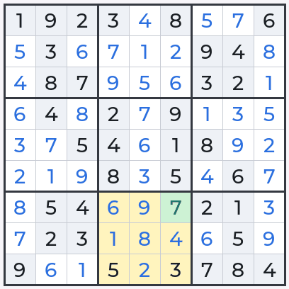

<!-- Written by tools/walkthrough.py dutch-flatmates: edit the script, not this page. -->
# Dutch Flatmates, step 45: the 7 in box 8

**Step 45 of 45** · [← Step 44](step-44.md) · [All steps](../dutch-flatmates.md#the-whole-puzzle-step-by-step) · [All steps](../dutch-flatmates.md#the-whole-puzzle-step-by-step)

Box 8 needs a 7, and r7c6 is its last empty cell: **r7c6 = 7**.

Solved.

**Step 45 of 45** · [← Step 44](step-44.md) · [All steps](../dutch-flatmates.md#the-whole-puzzle-step-by-step) · [All steps](../dutch-flatmates.md#the-whole-puzzle-step-by-step)
