# Dutch Whispers

[← All variants](README.md) · [Puzzles](../features-puzzles.md) · [How to play](../how-to-play.md)

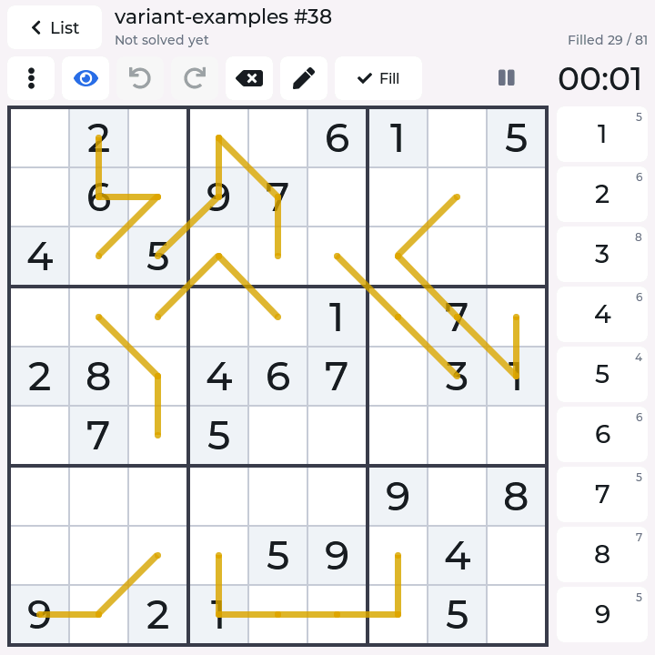

## The rules

[Classic](classic.md) rules, plus **amber lines** through cells side by side or diagonal. Along a line, **two neighbours differ by at least 4**: 3 next to 7 is fine, 3 next to 6 isn't. It's [German Whispers](german-whispers.md) with a gap of 4 instead of 5, so a **5 can be on a line**, but only between a 1 and a 9.

## On the board

- Each line is a narrow amber line under the digits.
- Two neighbours on a line less than 4 apart turn red.
- The grader and hints narrow each line cell by its neighbours: "Along this line, neighbours are 4 or more apart, so row 7, column 3 can only be 1, 2".
- **Puzzles → ⋮ → New puzzle → Lines → Dutch**: 8 lines (Hard and Expert 10) of 3 to 6 cells.

## How to solve it

- **A 5 is pinned:** the only digits 4 or more away from a 5 are 1 and 9. A 5 in the middle of a line has a 1 on one side and a 9 on the other.
- **4 and 6 are tight:** next to a 4, a cell is 8 or 9; next to a 6, 1 or 2.
- **Low and high mostly alternate:** with a gap of 4, two neighbours can't both be 1–4 or both be 6–9 (the most two such digits differ by is 3). Only a 5 breaks the pattern.
- **Next to an extreme, more is left than in German Whispers:** next to a 9, a cell is 1 to 5; next to a 1, 5 to 9.

## Worked example

**variant-examples #38**, Dutch Whispers Easy (see [Classic](classic.md#worked-example-the-whole-puzzle) for how to import the examples; cells are written r*row*c*column*). The lines are in the screenshot; two matter here:

- r3c5, r2c5 (a 7), r1c4, r2c4 (a 9), r3c3 (a 5): the 5 at its end sits next to a 9, 4 away;
- r1c2 (a 2), r2c2 (a 6), r2c3, r3c2.

**Step 1: r1c4, between a 7 and a 9.** Row 1 has 1, 2, 5 and 6; column 4 has 4 and 9; box 2 has a 7; that leaves 3 and 8. On its line, r1c4 is next to the 7 in r2c5 and the 9 in r2c4, and 8 is only 1 away from either. **r1c4 = 3**.

**Step 2: r2c3, next to a 6.** Row 2 has 6, 7 and 9; column 3 has 2 and 5; box 1 has a 4; that leaves 1, 3 and 8. On its line, r2c3 is next to the 6 in r2c2: 3 and 8 are less than 4 away from it. **r2c3 = 1**.

**Step 3: r3c2, next to step 2's 1.** Row 3 has 4 and 5; column 2 has 2, 6, 7 and 8; box 1 has the new 1; that leaves 3 and 9. On its line, r3c2 is next to the 1 in r2c3, and 3 is only 2 away. **r3c2 = 9**.

## The whole puzzle, step by step

<!-- walkthrough -->
<!-- Written by tools/walkthrough.py dutch-whispers: edit the script, not this part. -->

The whole puzzle, from the start to the last cell: 52 steps, each one a single (one place left for a digit, or one digit left for a cell), taken in the order a box's single comes first, so not quite the order of the worked example above. In each picture, the unit the step looks at is tinted yellow (for a cell with one digit left: its row, column and box), the new digit is on green, the digits that rule cells out have an **orange ring**, and the empty cells they rule out a **red cross**. Givens are on grey, digits from earlier steps in blue.

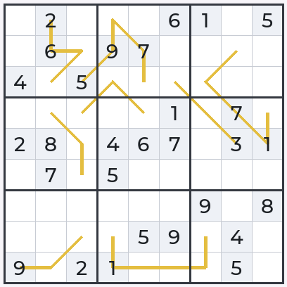

#### Step 1: the 1 in box 2

Box 2 needs a 1. r1c4 and r1c5: row 1 has one (r1c7). r2c6 and r3c6: column 6 has one (r4c6). r3c4: column 4 has one (r9c4). Only **r3c5** is left: **r3c5 = 1**.

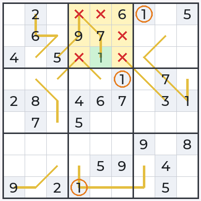

#### Step 2: the 5 in box 2

Box 2 needs a 5. r1c4 and r1c5: row 1 has one (r1c9). r3c4 and r3c6: row 3 has one (r3c3). Only **r2c6** is left: **r2c6 = 5**.

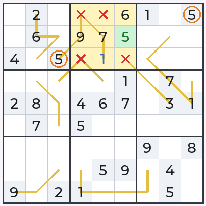

#### Step 3: the 4 in box 2

Box 2 needs a 4. r1c4: column 4 has one (r5c4). r3c4 and r3c6: row 3 has one (r3c1). Only **r1c5** is left: **r1c5 = 4**.

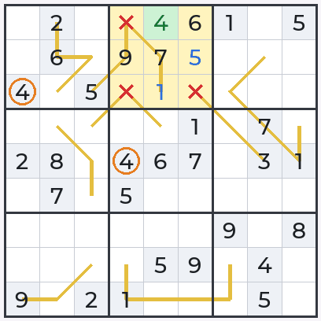

#### Step 4: the 7 in box 3

Box 3 needs a 7. r1c8 and r3c8: column 8 has one (r4c8). r2c7, r2c8 and r2c9: row 2 has one (r2c5). r3c7: it's next to the 7 in r4c8 on an amber line, and 7 is less than 4 away from it. Only **r3c9** is left: **r3c9 = 7**.

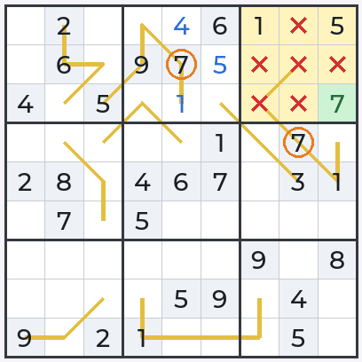

#### Step 5: the 6 in box 3

Box 3 needs a 6. r1c8: row 1 has one (r1c6). r2c7, r2c8 and r2c9: row 2 has one (r2c2). r3c7: it's next to the 7 in r4c8 on an amber line, and 6 is less than 4 away from it. Only **r3c8** is left: **r3c8 = 6**.

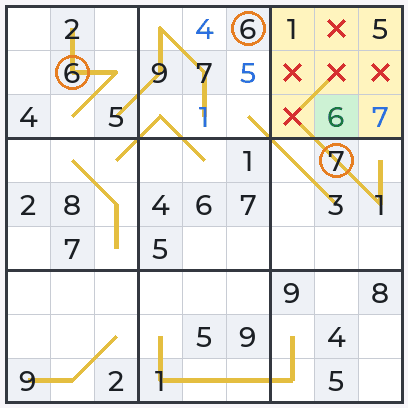

#### Step 6: the 9 in box 3

Box 3 needs a 9. r2c7, r2c8 and r2c9: row 2 has one (r2c4). r3c7: column 7 has one (r7c7). Only **r1c8** is left: **r1c8 = 9**.

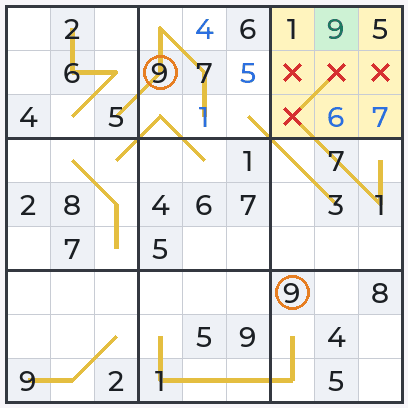

#### Step 7: the 9 in box 1

Box 1 needs a 9. r1c1 and r1c3: row 1 has one (r1c8). r2c1 and r2c3: row 2 has one (r2c4). Only **r3c2** is left: **r3c2 = 9**.

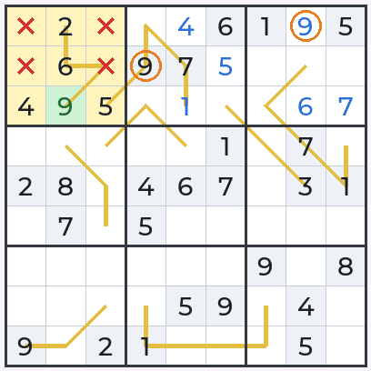

#### Step 8: the 5 in box 6

Box 6 needs a 5. r4c9: column 9 has one (r1c9). r6c7, r6c8 and r6c9: row 6 has one (r6c4). r4c7: it's next to the 3 in r5c8 on an amber line, and 5 is less than 4 away from it. Only **r5c7** is left: **r5c7 = 5**.

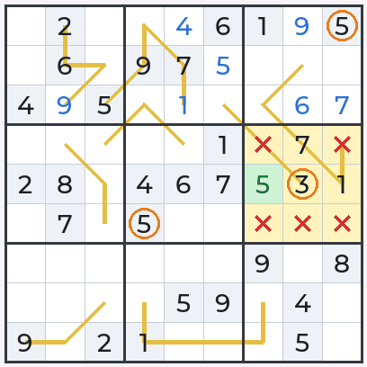

#### Step 9: the 1 in box 9

Box 9 needs a 1. r8c7: column 7 has one (r1c7). r8c9: column 9 has one (r5c9). r9c7 and r9c9: row 9 has one (r9c4). Only **r7c8** is left: **r7c8 = 1**.

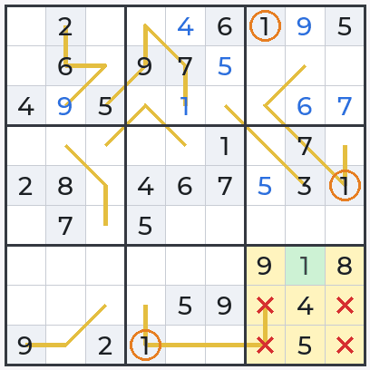

#### Step 10: the 9 in row 5

Row 5 needs a 9, and r5c3 is its last empty cell: **r5c3 = 9**.

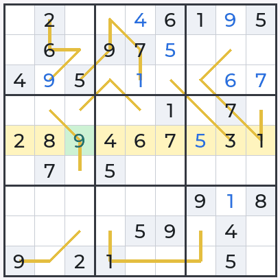

#### Step 11: the 7 in row 9

Row 9 needs a 7. r9c2: column 2 has one (r6c2). r9c5: column 5 has one (r2c5). r9c6: column 6 has one (r5c6). r9c9: column 9 has one (r3c9). Only **r9c7** is left: **r9c7 = 7**.

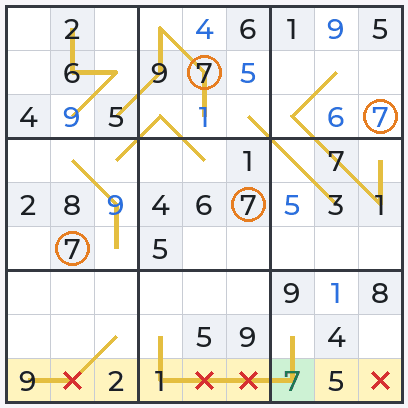

#### Step 12: the 4 in box 8

Box 8 needs a 4. r7c4: column 4 has one (r5c4). r7c5 and r9c5: column 5 has one (r1c5). r8c4: row 8 has one (r8c8). r9c6: it's next to the 7 in r9c7 on an amber line, and 4 is less than 4 away from it. Only **r7c6** is left: **r7c6 = 4**.

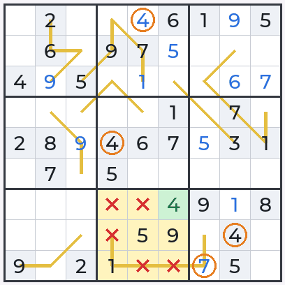

#### Step 13: the 4 in box 7

Box 7 needs a 4. r7c1, r7c2 and r7c3: row 7 has one (r7c6). r8c1, r8c2 and r8c3: row 8 has one (r8c8). Only **r9c2** is left: **r9c2 = 4**.

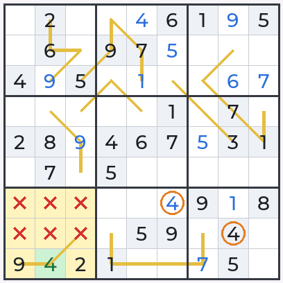

#### Step 14: the 4 in row 4

Row 4 needs a 4. r4c1: column 1 has one (r3c1). r4c2: column 2 has one (r9c2). r4c4: column 4 has one (r5c4). r4c5: column 5 has one (r1c5). r4c7: it's next to the 3 in r5c8 on an amber line, and 4 is less than 4 away from it. r4c9: it's next to the 1 in r5c9 on an amber line, and 4 is less than 4 away from it. Only **r4c3** is left: **r4c3 = 4**.

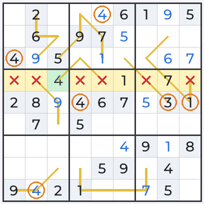

#### Step 15: the 2 in box 2

Box 2 needs a 2. r1c4: row 1 has one (r1c2). r3c4: it's next to the 4 in r4c3 on an amber line, and 2 is less than 4 away from it. Only **r3c6** is left: **r3c6 = 2**.

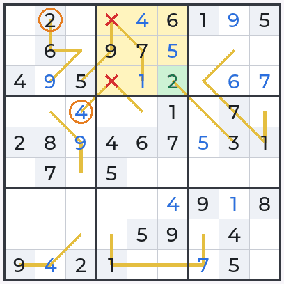

#### Step 16: the 3 in box 2

Box 2 needs a 3. r3c4: it's next to the 4 in r4c3 on an amber line, and 3 is less than 4 away from it. Only **r1c4** is left: **r1c4 = 3**.

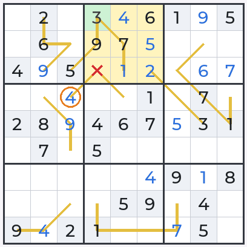

#### Step 17: the 3 in box 1

Box 1 needs a 3. r1c1 and r1c3: row 1 has one (r1c4). r2c3: it's next to the 6 in r2c2 on an amber line, and 3 is less than 4 away from it. Only **r2c1** is left: **r2c1 = 3**.

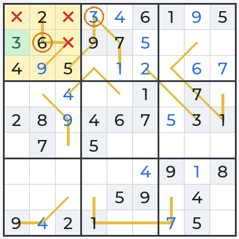

#### Step 18: the 1 in box 1

Box 1 needs a 1. r1c1 and r1c3: row 1 has one (r1c7). Only **r2c3** is left: **r2c3 = 1**.

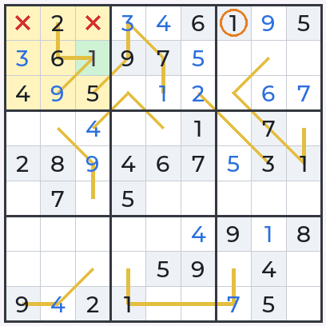

#### Step 19: the 8 in box 2

Box 2 needs an 8, and r3c4 is its last empty cell: **r3c4 = 8**.

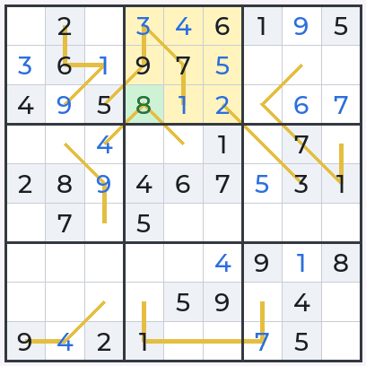

#### Step 20: the 3 in box 3

Box 3 needs a 3. r2c7, r2c8 and r2c9: row 2 has one (r2c1). Only **r3c7** is left: **r3c7 = 3**.

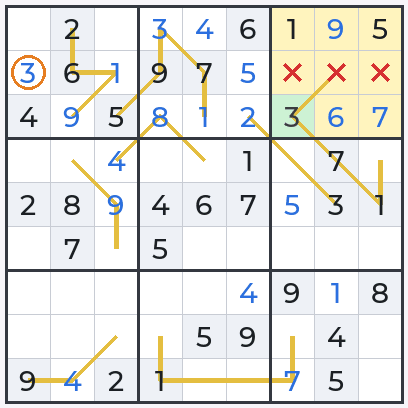

#### Step 21: the 1 in box 4

Box 4 needs a 1. r4c1 and r4c2: row 4 has one (r4c6). r6c3: column 3 has one (r2c3). Only **r6c1** is left: **r6c1 = 1**.

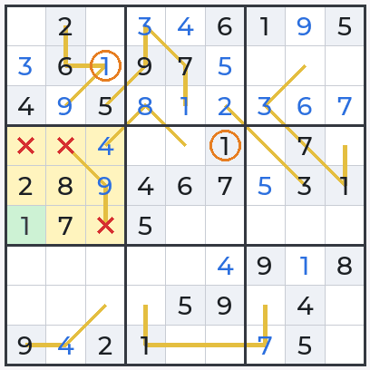

#### Step 22: the 6 in box 4

Box 4 needs a 6. r4c2: column 2 has one (r2c2). r6c3: it's next to the 9 in r5c3 on an amber line, and 6 is less than 4 away from it. Only **r4c1** is left: **r4c1 = 6**.

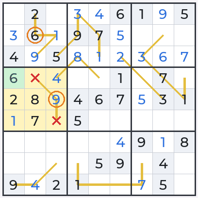

#### Step 23: the 5 in box 4

Box 4 needs a 5. r6c3: row 6 has one (r6c4). Only **r4c2** is left: **r4c2 = 5**.

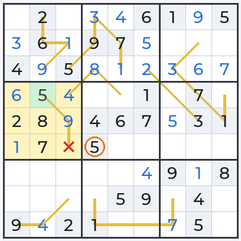

#### Step 24: the 3 in box 4

Box 4 needs a 3, and r6c3 is its last empty cell: **r6c3 = 3**.

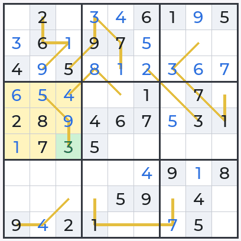

#### Step 25: the 3 in box 5

Box 5 needs a 3. r4c4: column 4 has one (r1c4). r6c5 and r6c6: row 6 has one (r6c3). Only **r4c5** is left: **r4c5 = 3**.

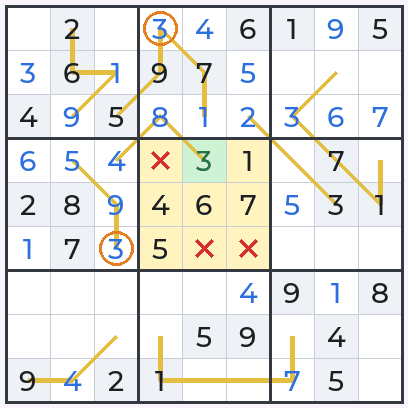

#### Step 26: the 9 in box 5

Box 5 needs a 9. r4c4: column 4 has one (r2c4). r6c6: column 6 has one (r8c6). Only **r6c5** is left: **r6c5 = 9**.

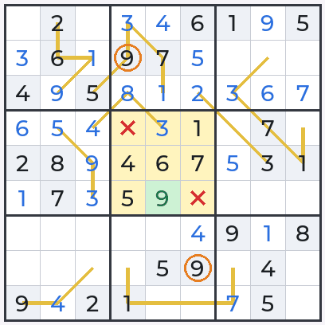

#### Step 27: the 2 in box 5

Box 5 needs a 2. r6c6: column 6 has one (r3c6). Only **r4c4** is left: **r4c4 = 2**.

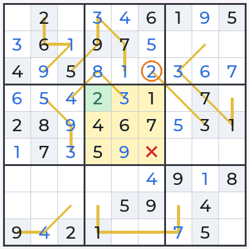

#### Step 28: the 8 in box 5

Box 5 needs an 8, and r6c6 is its last empty cell: **r6c6 = 8**.

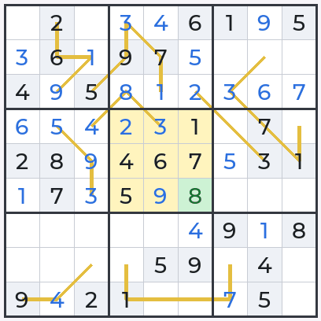

#### Step 29: the 8 in box 6

Box 6 needs an 8. r4c9: column 9 has one (r7c9). r6c7, r6c8 and r6c9: row 6 has one (r6c6). Only **r4c7** is left: **r4c7 = 8**.

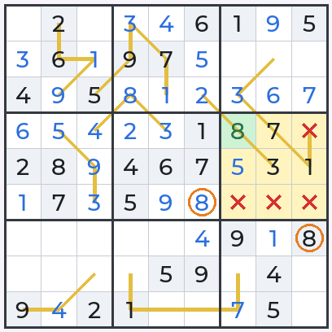

#### Step 30: the 8 in box 3

Box 3 needs an 8. r2c7: column 7 has one (r4c7). r2c9: column 9 has one (r7c9). Only **r2c8** is left: **r2c8 = 8**.

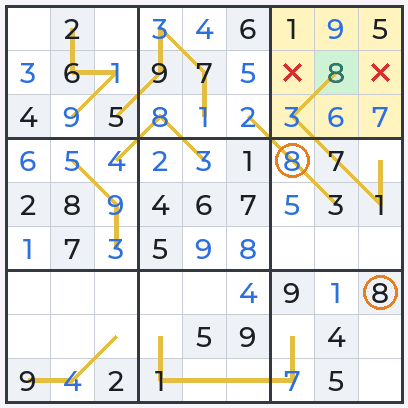

#### Step 31: the 9 in box 6

Box 6 needs a 9. r6c7, r6c8 and r6c9: row 6 has one (r6c5). Only **r4c9** is left: **r4c9 = 9**.

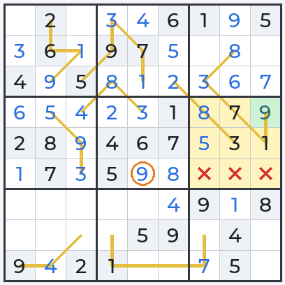

#### Step 32: the 1 in box 7

Box 7 needs a 1. r7c1, r7c2 and r7c3: row 7 has one (r7c8). r8c1: column 1 has one (r6c1). r8c3: column 3 has one (r2c3). Only **r8c2** is left: **r8c2 = 1**.

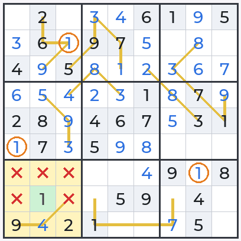

#### Step 33: the 3 in box 7

Box 7 needs a 3. r7c1 and r8c1: column 1 has one (r2c1). r7c3 and r8c3: column 3 has one (r6c3). Only **r7c2** is left: **r7c2 = 3**.

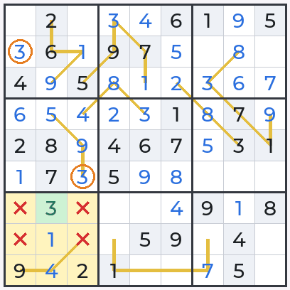

#### Step 34: the 5 in box 7

Box 7 needs a 5. r7c3: column 3 has one (r3c3). r8c1 and r8c3: row 8 has one (r8c5). Only **r7c1** is left: **r7c1 = 5**.

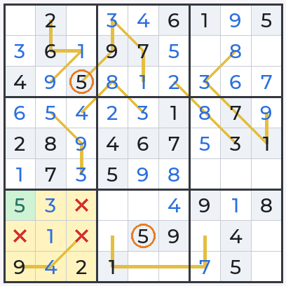

#### Step 35: the 6 in box 7

Box 7 needs a 6. r8c1: column 1 has one (r4c1). r8c3: it's next to the 4 in r9c2 on an amber line, and 6 is less than 4 away from it. Only **r7c3** is left: **r7c3 = 6**.

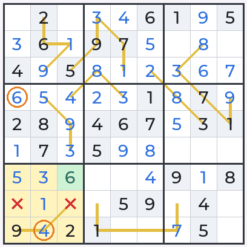

#### Step 36: the 7 in box 7

Box 7 needs a 7. r8c3: it's next to the 4 in r9c2 on an amber line, and 7 is less than 4 away from it. Only **r8c1** is left: **r8c1 = 7**.

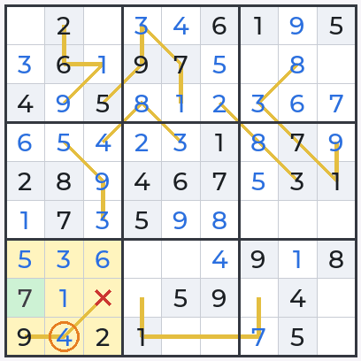

#### Step 37: the 7 in box 1

Box 1 needs a 7. r1c1: column 1 has one (r8c1). Only **r1c3** is left: **r1c3 = 7**.

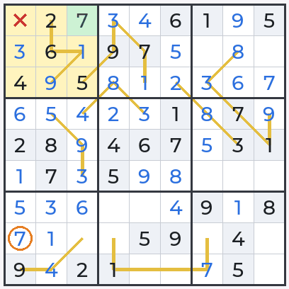

#### Step 38: the 8 in box 1

Box 1 needs an 8, and r1c1 is its last empty cell: **r1c1 = 8**.

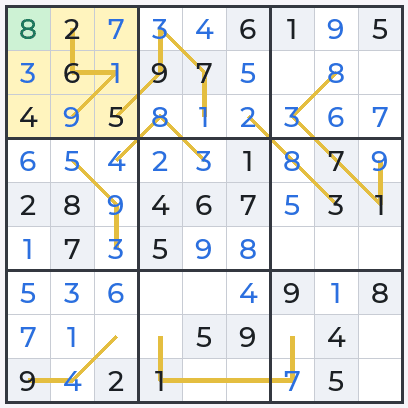

#### Step 39: the 8 in box 7

Box 7 needs an 8, and r8c3 is its last empty cell: **r8c3 = 8**.

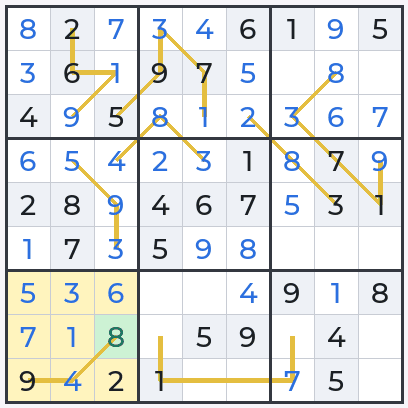

#### Step 40: the 2 in box 8

Box 8 needs a 2. r7c4 and r8c4: column 4 has one (r4c4). r9c5 and r9c6: row 9 has one (r9c3). Only **r7c5** is left: **r7c5 = 2**.

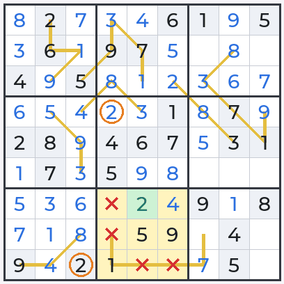

#### Step 41: the 3 in box 8

Box 8 needs a 3. r7c4: row 7 has one (r7c2). r8c4: column 4 has one (r1c4). r9c5: column 5 has one (r4c5). Only **r9c6** is left: **r9c6 = 3**.

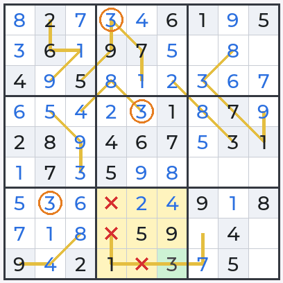

#### Step 42: the 6 in box 8

Box 8 needs a 6. r7c4: row 7 has one (r7c3). r9c5: column 5 has one (r5c5). Only **r8c4** is left: **r8c4 = 6**.

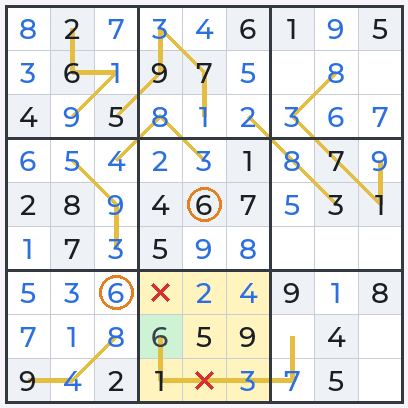

#### Step 43: the 7 in box 8

Box 8 needs a 7. r9c5: row 9 has one (r9c7). Only **r7c4** is left: **r7c4 = 7**.

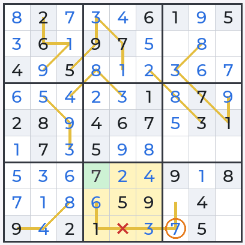

#### Step 44: the 8 in box 8

Box 8 needs an 8, and r9c5 is its last empty cell: **r9c5 = 8**.

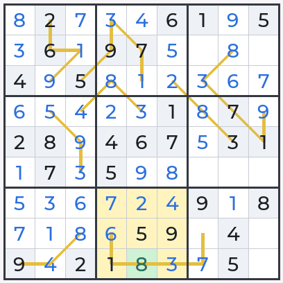

#### Step 45: the 3 in box 9

Box 9 needs a 3. r8c7: column 7 has one (r3c7). r9c9: row 9 has one (r9c6). Only **r8c9** is left: **r8c9 = 3**.

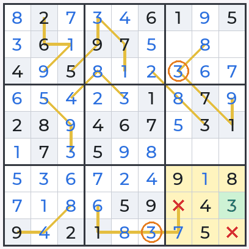

#### Step 46: the 2 in box 9

Box 9 needs a 2. r9c9: row 9 has one (r9c3). Only **r8c7** is left: **r8c7 = 2**.

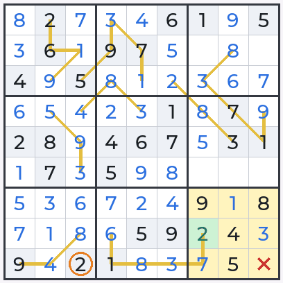

#### Step 47: the 2 in box 3

Box 3 needs a 2. r2c7: column 7 has one (r8c7). Only **r2c9** is left: **r2c9 = 2**.

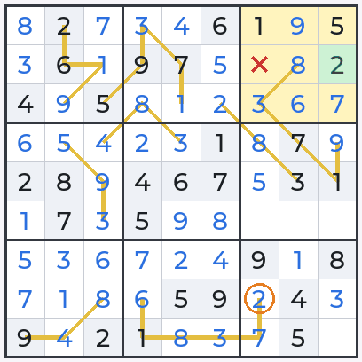

#### Step 48: the 4 in box 3

Box 3 needs a 4, and r2c7 is its last empty cell: **r2c7 = 4**.

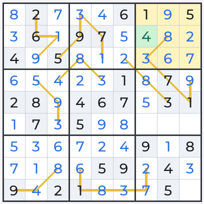

#### Step 49: the 2 in box 6

Box 6 needs a 2. r6c7: column 7 has one (r8c7). r6c9: column 9 has one (r2c9). Only **r6c8** is left: **r6c8 = 2**.

#### Step 50: the 4 in box 6

Box 6 needs a 4. r6c7: column 7 has one (r2c7). Only **r6c9** is left: **r6c9 = 4**.

#### Step 51: the 6 in box 6

Box 6 needs a 6, and r6c7 is its last empty cell: **r6c7 = 6**.

#### Step 52: the 6 in box 9

Box 9 needs a 6, and r9c9 is its last empty cell: **r9c9 = 6**.

Solved.

<!-- /walkthrough -->
