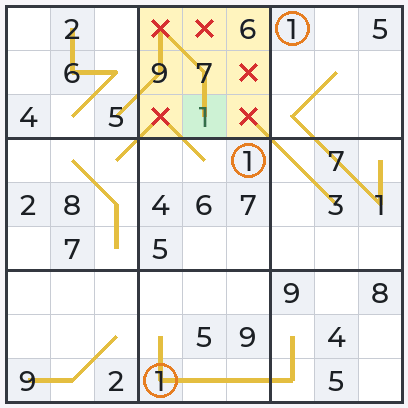

<!-- Written by tools/walkthrough.py dutch-whispers: edit the script, not this page. -->
# Dutch Whispers, step 1: the 1 in box 2

**Step 1 of 52** · [← The start](../dutch-whispers.md#the-whole-puzzle-step-by-step) · [All steps](../dutch-whispers.md#the-whole-puzzle-step-by-step) · [Step 2 →](step-02.md)

Box 2 needs a 1. r1c4 and r1c5: row 1 has one (r1c7). r2c6 and r3c6: column 6 has one (r4c6). r3c4: column 4 has one (r9c4). Only **r3c5** is left: **r3c5 = 1**.

**Step 1 of 52** · [← The start](../dutch-whispers.md#the-whole-puzzle-step-by-step) · [All steps](../dutch-whispers.md#the-whole-puzzle-step-by-step) · [Step 2 →](step-02.md)
