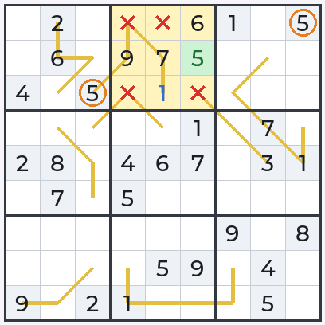

<!-- Written by tools/walkthrough.py dutch-whispers: edit the script, not this page. -->
# Dutch Whispers, step 2: the 5 in box 2

**Step 2 of 52** · [← Step 1](step-01.md) · [All steps](../dutch-whispers.md#the-whole-puzzle-step-by-step) · [Step 3 →](step-03.md)

Box 2 needs a 5. r1c4 and r1c5: row 1 has one (r1c9). r3c4 and r3c6: row 3 has one (r3c3). Only **r2c6** is left: **r2c6 = 5**.

**Step 2 of 52** · [← Step 1](step-01.md) · [All steps](../dutch-whispers.md#the-whole-puzzle-step-by-step) · [Step 3 →](step-03.md)
