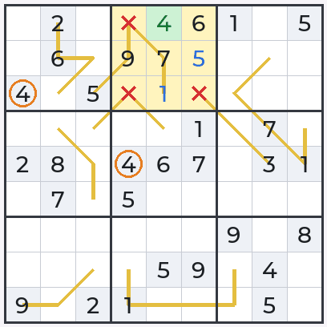

<!-- Written by tools/walkthrough.py dutch-whispers: edit the script, not this page. -->
# Dutch Whispers, step 3: the 4 in box 2

**Step 3 of 52** · [← Step 2](step-02.md) · [All steps](../dutch-whispers.md#the-whole-puzzle-step-by-step) · [Step 4 →](step-04.md)

Box 2 needs a 4. r1c4: column 4 has one (r5c4). r3c4 and r3c6: row 3 has one (r3c1). Only **r1c5** is left: **r1c5 = 4**.

**Step 3 of 52** · [← Step 2](step-02.md) · [All steps](../dutch-whispers.md#the-whole-puzzle-step-by-step) · [Step 4 →](step-04.md)
