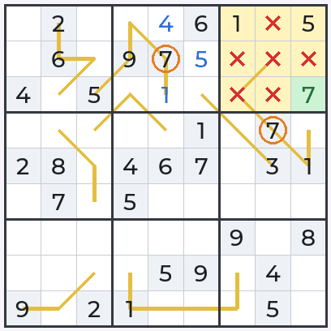

<!-- Written by tools/walkthrough.py dutch-whispers: edit the script, not this page. -->
# Dutch Whispers, step 4: the 7 in box 3

**Step 4 of 52** · [← Step 3](step-03.md) · [All steps](../dutch-whispers.md#the-whole-puzzle-step-by-step) · [Step 5 →](step-05.md)

Box 3 needs a 7. r1c8 and r3c8: column 8 has one (r4c8). r2c7, r2c8 and r2c9: row 2 has one (r2c5). r3c7: it's next to the 7 in r4c8 on an amber line, and 7 is less than 4 away from it. Only **r3c9** is left: **r3c9 = 7**.

**Step 4 of 52** · [← Step 3](step-03.md) · [All steps](../dutch-whispers.md#the-whole-puzzle-step-by-step) · [Step 5 →](step-05.md)
