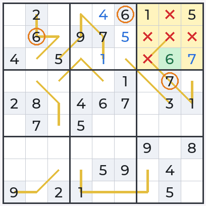

<!-- Written by tools/walkthrough.py dutch-whispers: edit the script, not this page. -->
# Dutch Whispers, step 5: the 6 in box 3

**Step 5 of 52** · [← Step 4](step-04.md) · [All steps](../dutch-whispers.md#the-whole-puzzle-step-by-step) · [Step 6 →](step-06.md)

Box 3 needs a 6. r1c8: row 1 has one (r1c6). r2c7, r2c8 and r2c9: row 2 has one (r2c2). r3c7: it's next to the 7 in r4c8 on an amber line, and 6 is less than 4 away from it. Only **r3c8** is left: **r3c8 = 6**.

**Step 5 of 52** · [← Step 4](step-04.md) · [All steps](../dutch-whispers.md#the-whole-puzzle-step-by-step) · [Step 6 →](step-06.md)
