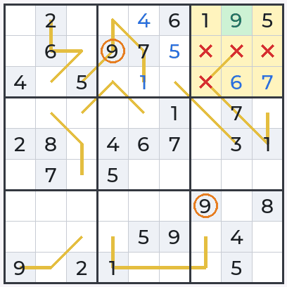

<!-- Written by tools/walkthrough.py dutch-whispers: edit the script, not this page. -->
# Dutch Whispers, step 6: the 9 in box 3

**Step 6 of 52** · [← Step 5](step-05.md) · [All steps](../dutch-whispers.md#the-whole-puzzle-step-by-step) · [Step 7 →](step-07.md)

Box 3 needs a 9. r2c7, r2c8 and r2c9: row 2 has one (r2c4). r3c7: column 7 has one (r7c7). Only **r1c8** is left: **r1c8 = 9**.

**Step 6 of 52** · [← Step 5](step-05.md) · [All steps](../dutch-whispers.md#the-whole-puzzle-step-by-step) · [Step 7 →](step-07.md)
