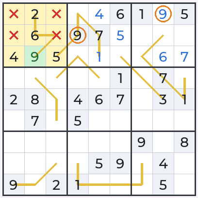

<!-- Written by tools/walkthrough.py dutch-whispers: edit the script, not this page. -->
# Dutch Whispers, step 7: the 9 in box 1

**Step 7 of 52** · [← Step 6](step-06.md) · [All steps](../dutch-whispers.md#the-whole-puzzle-step-by-step) · [Step 8 →](step-08.md)

Box 1 needs a 9. r1c1 and r1c3: row 1 has one (r1c8). r2c1 and r2c3: row 2 has one (r2c4). Only **r3c2** is left: **r3c2 = 9**.

**Step 7 of 52** · [← Step 6](step-06.md) · [All steps](../dutch-whispers.md#the-whole-puzzle-step-by-step) · [Step 8 →](step-08.md)
