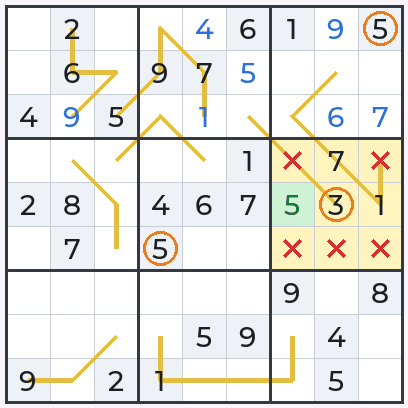

<!-- Written by tools/walkthrough.py dutch-whispers: edit the script, not this page. -->
# Dutch Whispers, step 8: the 5 in box 6

**Step 8 of 52** · [← Step 7](step-07.md) · [All steps](../dutch-whispers.md#the-whole-puzzle-step-by-step) · [Step 9 →](step-09.md)

Box 6 needs a 5. r4c9: column 9 has one (r1c9). r6c7, r6c8 and r6c9: row 6 has one (r6c4). r4c7: it's next to the 3 in r5c8 on an amber line, and 5 is less than 4 away from it. Only **r5c7** is left: **r5c7 = 5**.

**Step 8 of 52** · [← Step 7](step-07.md) · [All steps](../dutch-whispers.md#the-whole-puzzle-step-by-step) · [Step 9 →](step-09.md)
