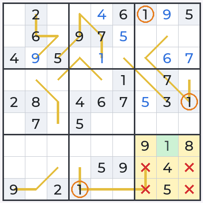

<!-- Written by tools/walkthrough.py dutch-whispers: edit the script, not this page. -->
# Dutch Whispers, step 9: the 1 in box 9

**Step 9 of 52** · [← Step 8](step-08.md) · [All steps](../dutch-whispers.md#the-whole-puzzle-step-by-step) · [Step 10 →](step-10.md)

Box 9 needs a 1. r8c7: column 7 has one (r1c7). r8c9: column 9 has one (r5c9). r9c7 and r9c9: row 9 has one (r9c4). Only **r7c8** is left: **r7c8 = 1**.

**Step 9 of 52** · [← Step 8](step-08.md) · [All steps](../dutch-whispers.md#the-whole-puzzle-step-by-step) · [Step 10 →](step-10.md)
