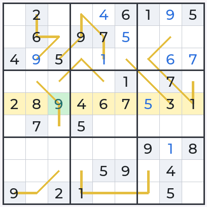

<!-- Written by tools/walkthrough.py dutch-whispers: edit the script, not this page. -->
# Dutch Whispers, step 10: the 9 in row 5

**Step 10 of 52** · [← Step 9](step-09.md) · [All steps](../dutch-whispers.md#the-whole-puzzle-step-by-step) · [Step 11 →](step-11.md)

Row 5 needs a 9, and r5c3 is its last empty cell: **r5c3 = 9**.

**Step 10 of 52** · [← Step 9](step-09.md) · [All steps](../dutch-whispers.md#the-whole-puzzle-step-by-step) · [Step 11 →](step-11.md)
