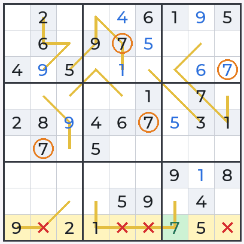

<!-- Written by tools/walkthrough.py dutch-whispers: edit the script, not this page. -->
# Dutch Whispers, step 11: the 7 in row 9

**Step 11 of 52** · [← Step 10](step-10.md) · [All steps](../dutch-whispers.md#the-whole-puzzle-step-by-step) · [Step 12 →](step-12.md)

Row 9 needs a 7. r9c2: column 2 has one (r6c2). r9c5: column 5 has one (r2c5). r9c6: column 6 has one (r5c6). r9c9: column 9 has one (r3c9). Only **r9c7** is left: **r9c7 = 7**.

**Step 11 of 52** · [← Step 10](step-10.md) · [All steps](../dutch-whispers.md#the-whole-puzzle-step-by-step) · [Step 12 →](step-12.md)
