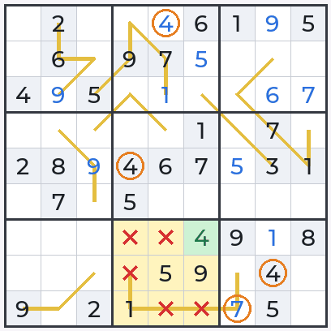

<!-- Written by tools/walkthrough.py dutch-whispers: edit the script, not this page. -->
# Dutch Whispers, step 12: the 4 in box 8

**Step 12 of 52** · [← Step 11](step-11.md) · [All steps](../dutch-whispers.md#the-whole-puzzle-step-by-step) · [Step 13 →](step-13.md)

Box 8 needs a 4. r7c4: column 4 has one (r5c4). r7c5 and r9c5: column 5 has one (r1c5). r8c4: row 8 has one (r8c8). r9c6: it's next to the 7 in r9c7 on an amber line, and 4 is less than 4 away from it. Only **r7c6** is left: **r7c6 = 4**.

**Step 12 of 52** · [← Step 11](step-11.md) · [All steps](../dutch-whispers.md#the-whole-puzzle-step-by-step) · [Step 13 →](step-13.md)
