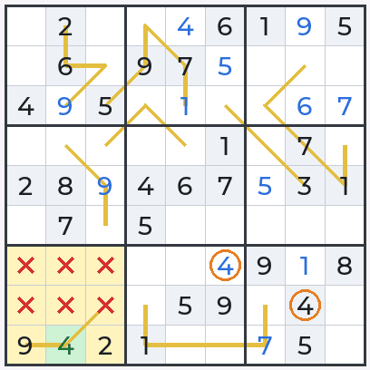

<!-- Written by tools/walkthrough.py dutch-whispers: edit the script, not this page. -->
# Dutch Whispers, step 13: the 4 in box 7

**Step 13 of 52** · [← Step 12](step-12.md) · [All steps](../dutch-whispers.md#the-whole-puzzle-step-by-step) · [Step 14 →](step-14.md)

Box 7 needs a 4. r7c1, r7c2 and r7c3: row 7 has one (r7c6). r8c1, r8c2 and r8c3: row 8 has one (r8c8). Only **r9c2** is left: **r9c2 = 4**.

**Step 13 of 52** · [← Step 12](step-12.md) · [All steps](../dutch-whispers.md#the-whole-puzzle-step-by-step) · [Step 14 →](step-14.md)
