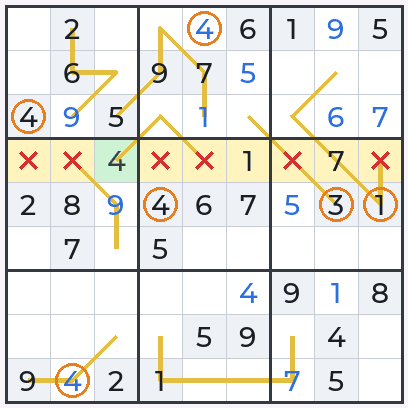

<!-- Written by tools/walkthrough.py dutch-whispers: edit the script, not this page. -->
# Dutch Whispers, step 14: the 4 in row 4

**Step 14 of 52** · [← Step 13](step-13.md) · [All steps](../dutch-whispers.md#the-whole-puzzle-step-by-step) · [Step 15 →](step-15.md)

Row 4 needs a 4. r4c1: column 1 has one (r3c1). r4c2: column 2 has one (r9c2). r4c4: column 4 has one (r5c4). r4c5: column 5 has one (r1c5). r4c7: it's next to the 3 in r5c8 on an amber line, and 4 is less than 4 away from it. r4c9: it's next to the 1 in r5c9 on an amber line, and 4 is less than 4 away from it. Only **r4c3** is left: **r4c3 = 4**.

**Step 14 of 52** · [← Step 13](step-13.md) · [All steps](../dutch-whispers.md#the-whole-puzzle-step-by-step) · [Step 15 →](step-15.md)
