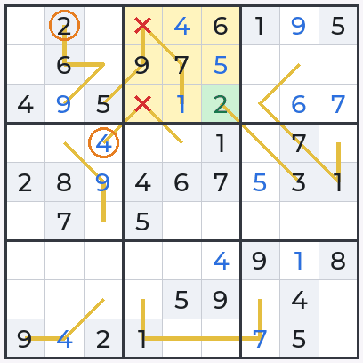

<!-- Written by tools/walkthrough.py dutch-whispers: edit the script, not this page. -->
# Dutch Whispers, step 15: the 2 in box 2

**Step 15 of 52** · [← Step 14](step-14.md) · [All steps](../dutch-whispers.md#the-whole-puzzle-step-by-step) · [Step 16 →](step-16.md)

Box 2 needs a 2. r1c4: row 1 has one (r1c2). r3c4: it's next to the 4 in r4c3 on an amber line, and 2 is less than 4 away from it. Only **r3c6** is left: **r3c6 = 2**.

**Step 15 of 52** · [← Step 14](step-14.md) · [All steps](../dutch-whispers.md#the-whole-puzzle-step-by-step) · [Step 16 →](step-16.md)
