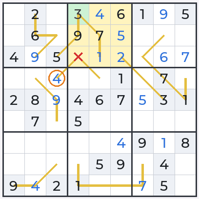

<!-- Written by tools/walkthrough.py dutch-whispers: edit the script, not this page. -->
# Dutch Whispers, step 16: the 3 in box 2

**Step 16 of 52** · [← Step 15](step-15.md) · [All steps](../dutch-whispers.md#the-whole-puzzle-step-by-step) · [Step 17 →](step-17.md)

Box 2 needs a 3. r3c4: it's next to the 4 in r4c3 on an amber line, and 3 is less than 4 away from it. Only **r1c4** is left: **r1c4 = 3**.

**Step 16 of 52** · [← Step 15](step-15.md) · [All steps](../dutch-whispers.md#the-whole-puzzle-step-by-step) · [Step 17 →](step-17.md)
