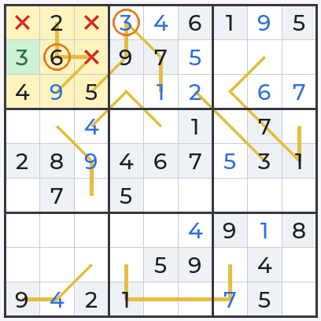

<!-- Written by tools/walkthrough.py dutch-whispers: edit the script, not this page. -->
# Dutch Whispers, step 17: the 3 in box 1

**Step 17 of 52** · [← Step 16](step-16.md) · [All steps](../dutch-whispers.md#the-whole-puzzle-step-by-step) · [Step 18 →](step-18.md)

Box 1 needs a 3. r1c1 and r1c3: row 1 has one (r1c4). r2c3: it's next to the 6 in r2c2 on an amber line, and 3 is less than 4 away from it. Only **r2c1** is left: **r2c1 = 3**.

**Step 17 of 52** · [← Step 16](step-16.md) · [All steps](../dutch-whispers.md#the-whole-puzzle-step-by-step) · [Step 18 →](step-18.md)
