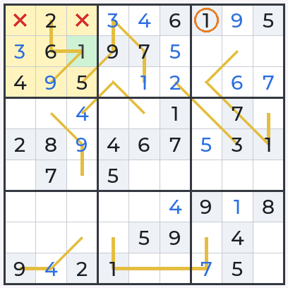

<!-- Written by tools/walkthrough.py dutch-whispers: edit the script, not this page. -->
# Dutch Whispers, step 18: the 1 in box 1

**Step 18 of 52** · [← Step 17](step-17.md) · [All steps](../dutch-whispers.md#the-whole-puzzle-step-by-step) · [Step 19 →](step-19.md)

Box 1 needs a 1. r1c1 and r1c3: row 1 has one (r1c7). Only **r2c3** is left: **r2c3 = 1**.

**Step 18 of 52** · [← Step 17](step-17.md) · [All steps](../dutch-whispers.md#the-whole-puzzle-step-by-step) · [Step 19 →](step-19.md)
