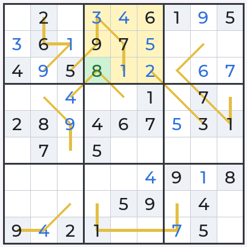

<!-- Written by tools/walkthrough.py dutch-whispers: edit the script, not this page. -->
# Dutch Whispers, step 19: the 8 in box 2

**Step 19 of 52** · [← Step 18](step-18.md) · [All steps](../dutch-whispers.md#the-whole-puzzle-step-by-step) · [Step 20 →](step-20.md)

Box 2 needs an 8, and r3c4 is its last empty cell: **r3c4 = 8**.

**Step 19 of 52** · [← Step 18](step-18.md) · [All steps](../dutch-whispers.md#the-whole-puzzle-step-by-step) · [Step 20 →](step-20.md)
