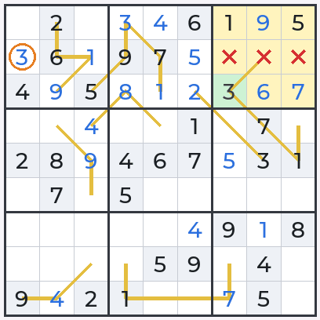

<!-- Written by tools/walkthrough.py dutch-whispers: edit the script, not this page. -->
# Dutch Whispers, step 20: the 3 in box 3

**Step 20 of 52** · [← Step 19](step-19.md) · [All steps](../dutch-whispers.md#the-whole-puzzle-step-by-step) · [Step 21 →](step-21.md)

Box 3 needs a 3. r2c7, r2c8 and r2c9: row 2 has one (r2c1). Only **r3c7** is left: **r3c7 = 3**.

**Step 20 of 52** · [← Step 19](step-19.md) · [All steps](../dutch-whispers.md#the-whole-puzzle-step-by-step) · [Step 21 →](step-21.md)
