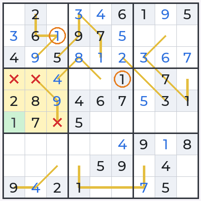

<!-- Written by tools/walkthrough.py dutch-whispers: edit the script, not this page. -->
# Dutch Whispers, step 21: the 1 in box 4

**Step 21 of 52** · [← Step 20](step-20.md) · [All steps](../dutch-whispers.md#the-whole-puzzle-step-by-step) · [Step 22 →](step-22.md)

Box 4 needs a 1. r4c1 and r4c2: row 4 has one (r4c6). r6c3: column 3 has one (r2c3). Only **r6c1** is left: **r6c1 = 1**.

**Step 21 of 52** · [← Step 20](step-20.md) · [All steps](../dutch-whispers.md#the-whole-puzzle-step-by-step) · [Step 22 →](step-22.md)
