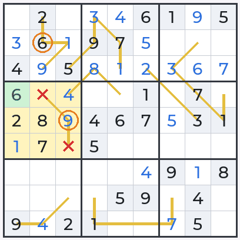

<!-- Written by tools/walkthrough.py dutch-whispers: edit the script, not this page. -->
# Dutch Whispers, step 22: the 6 in box 4

**Step 22 of 52** · [← Step 21](step-21.md) · [All steps](../dutch-whispers.md#the-whole-puzzle-step-by-step) · [Step 23 →](step-23.md)

Box 4 needs a 6. r4c2: column 2 has one (r2c2). r6c3: it's next to the 9 in r5c3 on an amber line, and 6 is less than 4 away from it. Only **r4c1** is left: **r4c1 = 6**.

**Step 22 of 52** · [← Step 21](step-21.md) · [All steps](../dutch-whispers.md#the-whole-puzzle-step-by-step) · [Step 23 →](step-23.md)
