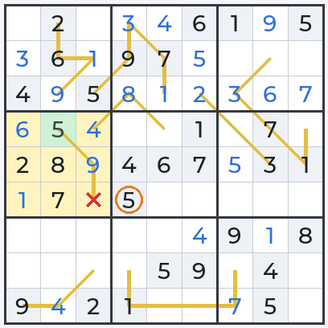

<!-- Written by tools/walkthrough.py dutch-whispers: edit the script, not this page. -->
# Dutch Whispers, step 23: the 5 in box 4

**Step 23 of 52** · [← Step 22](step-22.md) · [All steps](../dutch-whispers.md#the-whole-puzzle-step-by-step) · [Step 24 →](step-24.md)

Box 4 needs a 5. r6c3: row 6 has one (r6c4). Only **r4c2** is left: **r4c2 = 5**.

**Step 23 of 52** · [← Step 22](step-22.md) · [All steps](../dutch-whispers.md#the-whole-puzzle-step-by-step) · [Step 24 →](step-24.md)
