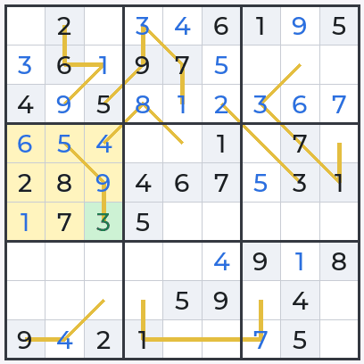

<!-- Written by tools/walkthrough.py dutch-whispers: edit the script, not this page. -->
# Dutch Whispers, step 24: the 3 in box 4

**Step 24 of 52** · [← Step 23](step-23.md) · [All steps](../dutch-whispers.md#the-whole-puzzle-step-by-step) · [Step 25 →](step-25.md)

Box 4 needs a 3, and r6c3 is its last empty cell: **r6c3 = 3**.

**Step 24 of 52** · [← Step 23](step-23.md) · [All steps](../dutch-whispers.md#the-whole-puzzle-step-by-step) · [Step 25 →](step-25.md)
