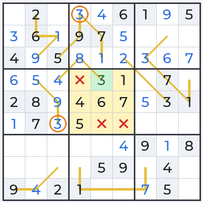

<!-- Written by tools/walkthrough.py dutch-whispers: edit the script, not this page. -->
# Dutch Whispers, step 25: the 3 in box 5

**Step 25 of 52** · [← Step 24](step-24.md) · [All steps](../dutch-whispers.md#the-whole-puzzle-step-by-step) · [Step 26 →](step-26.md)

Box 5 needs a 3. r4c4: column 4 has one (r1c4). r6c5 and r6c6: row 6 has one (r6c3). Only **r4c5** is left: **r4c5 = 3**.

**Step 25 of 52** · [← Step 24](step-24.md) · [All steps](../dutch-whispers.md#the-whole-puzzle-step-by-step) · [Step 26 →](step-26.md)
