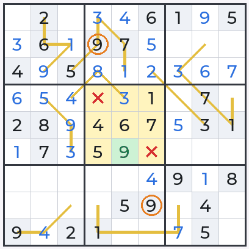

<!-- Written by tools/walkthrough.py dutch-whispers: edit the script, not this page. -->
# Dutch Whispers, step 26: the 9 in box 5

**Step 26 of 52** · [← Step 25](step-25.md) · [All steps](../dutch-whispers.md#the-whole-puzzle-step-by-step) · [Step 27 →](step-27.md)

Box 5 needs a 9. r4c4: column 4 has one (r2c4). r6c6: column 6 has one (r8c6). Only **r6c5** is left: **r6c5 = 9**.

**Step 26 of 52** · [← Step 25](step-25.md) · [All steps](../dutch-whispers.md#the-whole-puzzle-step-by-step) · [Step 27 →](step-27.md)
