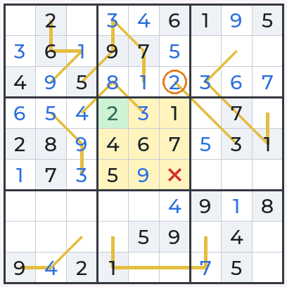

<!-- Written by tools/walkthrough.py dutch-whispers: edit the script, not this page. -->
# Dutch Whispers, step 27: the 2 in box 5

**Step 27 of 52** · [← Step 26](step-26.md) · [All steps](../dutch-whispers.md#the-whole-puzzle-step-by-step) · [Step 28 →](step-28.md)

Box 5 needs a 2. r6c6: column 6 has one (r3c6). Only **r4c4** is left: **r4c4 = 2**.

**Step 27 of 52** · [← Step 26](step-26.md) · [All steps](../dutch-whispers.md#the-whole-puzzle-step-by-step) · [Step 28 →](step-28.md)
