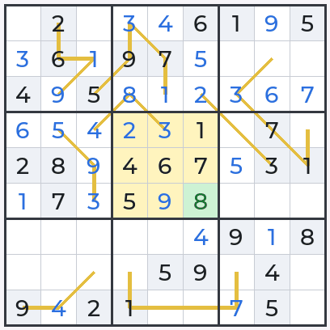

<!-- Written by tools/walkthrough.py dutch-whispers: edit the script, not this page. -->
# Dutch Whispers, step 28: the 8 in box 5

**Step 28 of 52** · [← Step 27](step-27.md) · [All steps](../dutch-whispers.md#the-whole-puzzle-step-by-step) · [Step 29 →](step-29.md)

Box 5 needs an 8, and r6c6 is its last empty cell: **r6c6 = 8**.

**Step 28 of 52** · [← Step 27](step-27.md) · [All steps](../dutch-whispers.md#the-whole-puzzle-step-by-step) · [Step 29 →](step-29.md)
