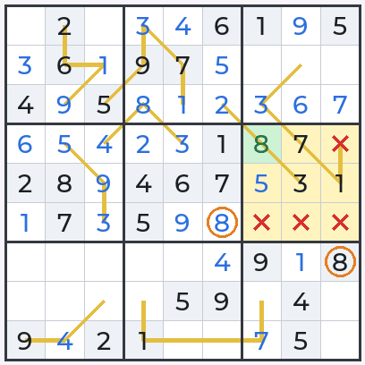

<!-- Written by tools/walkthrough.py dutch-whispers: edit the script, not this page. -->
# Dutch Whispers, step 29: the 8 in box 6

**Step 29 of 52** · [← Step 28](step-28.md) · [All steps](../dutch-whispers.md#the-whole-puzzle-step-by-step) · [Step 30 →](step-30.md)

Box 6 needs an 8. r4c9: column 9 has one (r7c9). r6c7, r6c8 and r6c9: row 6 has one (r6c6). Only **r4c7** is left: **r4c7 = 8**.

**Step 29 of 52** · [← Step 28](step-28.md) · [All steps](../dutch-whispers.md#the-whole-puzzle-step-by-step) · [Step 30 →](step-30.md)
