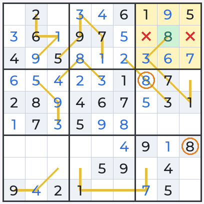

<!-- Written by tools/walkthrough.py dutch-whispers: edit the script, not this page. -->
# Dutch Whispers, step 30: the 8 in box 3

**Step 30 of 52** · [← Step 29](step-29.md) · [All steps](../dutch-whispers.md#the-whole-puzzle-step-by-step) · [Step 31 →](step-31.md)

Box 3 needs an 8. r2c7: column 7 has one (r4c7). r2c9: column 9 has one (r7c9). Only **r2c8** is left: **r2c8 = 8**.

**Step 30 of 52** · [← Step 29](step-29.md) · [All steps](../dutch-whispers.md#the-whole-puzzle-step-by-step) · [Step 31 →](step-31.md)
