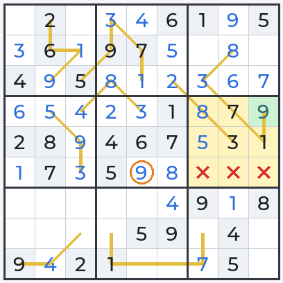

<!-- Written by tools/walkthrough.py dutch-whispers: edit the script, not this page. -->
# Dutch Whispers, step 31: the 9 in box 6

**Step 31 of 52** · [← Step 30](step-30.md) · [All steps](../dutch-whispers.md#the-whole-puzzle-step-by-step) · [Step 32 →](step-32.md)

Box 6 needs a 9. r6c7, r6c8 and r6c9: row 6 has one (r6c5). Only **r4c9** is left: **r4c9 = 9**.

**Step 31 of 52** · [← Step 30](step-30.md) · [All steps](../dutch-whispers.md#the-whole-puzzle-step-by-step) · [Step 32 →](step-32.md)
