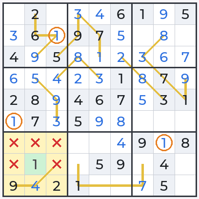

<!-- Written by tools/walkthrough.py dutch-whispers: edit the script, not this page. -->
# Dutch Whispers, step 32: the 1 in box 7

**Step 32 of 52** · [← Step 31](step-31.md) · [All steps](../dutch-whispers.md#the-whole-puzzle-step-by-step) · [Step 33 →](step-33.md)

Box 7 needs a 1. r7c1, r7c2 and r7c3: row 7 has one (r7c8). r8c1: column 1 has one (r6c1). r8c3: column 3 has one (r2c3). Only **r8c2** is left: **r8c2 = 1**.

**Step 32 of 52** · [← Step 31](step-31.md) · [All steps](../dutch-whispers.md#the-whole-puzzle-step-by-step) · [Step 33 →](step-33.md)
