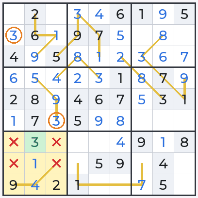

<!-- Written by tools/walkthrough.py dutch-whispers: edit the script, not this page. -->
# Dutch Whispers, step 33: the 3 in box 7

**Step 33 of 52** · [← Step 32](step-32.md) · [All steps](../dutch-whispers.md#the-whole-puzzle-step-by-step) · [Step 34 →](step-34.md)

Box 7 needs a 3. r7c1 and r8c1: column 1 has one (r2c1). r7c3 and r8c3: column 3 has one (r6c3). Only **r7c2** is left: **r7c2 = 3**.

**Step 33 of 52** · [← Step 32](step-32.md) · [All steps](../dutch-whispers.md#the-whole-puzzle-step-by-step) · [Step 34 →](step-34.md)
