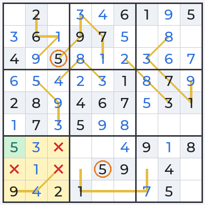

<!-- Written by tools/walkthrough.py dutch-whispers: edit the script, not this page. -->
# Dutch Whispers, step 34: the 5 in box 7

**Step 34 of 52** · [← Step 33](step-33.md) · [All steps](../dutch-whispers.md#the-whole-puzzle-step-by-step) · [Step 35 →](step-35.md)

Box 7 needs a 5. r7c3: column 3 has one (r3c3). r8c1 and r8c3: row 8 has one (r8c5). Only **r7c1** is left: **r7c1 = 5**.

**Step 34 of 52** · [← Step 33](step-33.md) · [All steps](../dutch-whispers.md#the-whole-puzzle-step-by-step) · [Step 35 →](step-35.md)
