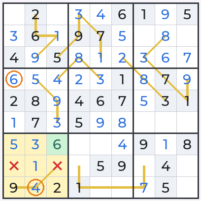

<!-- Written by tools/walkthrough.py dutch-whispers: edit the script, not this page. -->
# Dutch Whispers, step 35: the 6 in box 7

**Step 35 of 52** · [← Step 34](step-34.md) · [All steps](../dutch-whispers.md#the-whole-puzzle-step-by-step) · [Step 36 →](step-36.md)

Box 7 needs a 6. r8c1: column 1 has one (r4c1). r8c3: it's next to the 4 in r9c2 on an amber line, and 6 is less than 4 away from it. Only **r7c3** is left: **r7c3 = 6**.

**Step 35 of 52** · [← Step 34](step-34.md) · [All steps](../dutch-whispers.md#the-whole-puzzle-step-by-step) · [Step 36 →](step-36.md)
