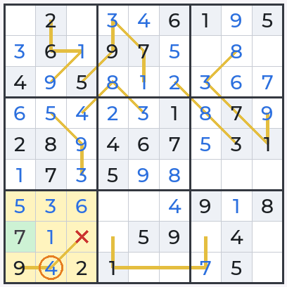

<!-- Written by tools/walkthrough.py dutch-whispers: edit the script, not this page. -->
# Dutch Whispers, step 36: the 7 in box 7

**Step 36 of 52** · [← Step 35](step-35.md) · [All steps](../dutch-whispers.md#the-whole-puzzle-step-by-step) · [Step 37 →](step-37.md)

Box 7 needs a 7. r8c3: it's next to the 4 in r9c2 on an amber line, and 7 is less than 4 away from it. Only **r8c1** is left: **r8c1 = 7**.

**Step 36 of 52** · [← Step 35](step-35.md) · [All steps](../dutch-whispers.md#the-whole-puzzle-step-by-step) · [Step 37 →](step-37.md)
