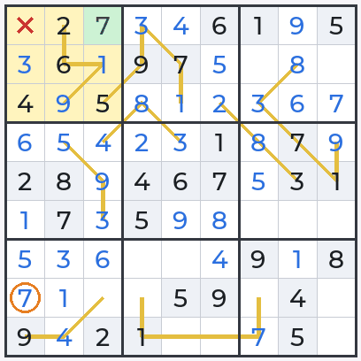

<!-- Written by tools/walkthrough.py dutch-whispers: edit the script, not this page. -->
# Dutch Whispers, step 37: the 7 in box 1

**Step 37 of 52** · [← Step 36](step-36.md) · [All steps](../dutch-whispers.md#the-whole-puzzle-step-by-step) · [Step 38 →](step-38.md)

Box 1 needs a 7. r1c1: column 1 has one (r8c1). Only **r1c3** is left: **r1c3 = 7**.

**Step 37 of 52** · [← Step 36](step-36.md) · [All steps](../dutch-whispers.md#the-whole-puzzle-step-by-step) · [Step 38 →](step-38.md)
