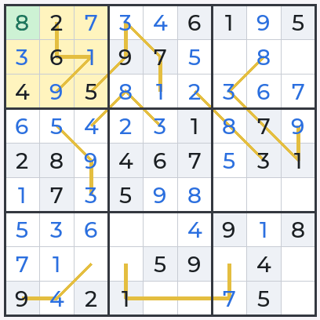

<!-- Written by tools/walkthrough.py dutch-whispers: edit the script, not this page. -->
# Dutch Whispers, step 38: the 8 in box 1

**Step 38 of 52** · [← Step 37](step-37.md) · [All steps](../dutch-whispers.md#the-whole-puzzle-step-by-step) · [Step 39 →](step-39.md)

Box 1 needs an 8, and r1c1 is its last empty cell: **r1c1 = 8**.

**Step 38 of 52** · [← Step 37](step-37.md) · [All steps](../dutch-whispers.md#the-whole-puzzle-step-by-step) · [Step 39 →](step-39.md)
