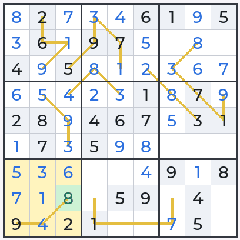

<!-- Written by tools/walkthrough.py dutch-whispers: edit the script, not this page. -->
# Dutch Whispers, step 39: the 8 in box 7

**Step 39 of 52** · [← Step 38](step-38.md) · [All steps](../dutch-whispers.md#the-whole-puzzle-step-by-step) · [Step 40 →](step-40.md)

Box 7 needs an 8, and r8c3 is its last empty cell: **r8c3 = 8**.

**Step 39 of 52** · [← Step 38](step-38.md) · [All steps](../dutch-whispers.md#the-whole-puzzle-step-by-step) · [Step 40 →](step-40.md)
