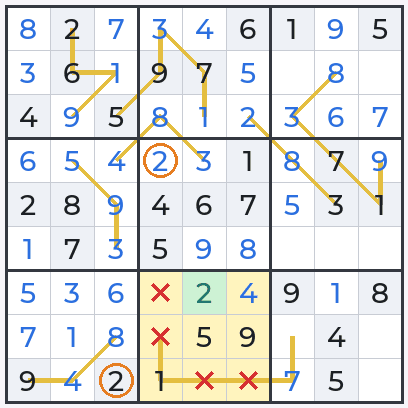

<!-- Written by tools/walkthrough.py dutch-whispers: edit the script, not this page. -->
# Dutch Whispers, step 40: the 2 in box 8

**Step 40 of 52** · [← Step 39](step-39.md) · [All steps](../dutch-whispers.md#the-whole-puzzle-step-by-step) · [Step 41 →](step-41.md)

Box 8 needs a 2. r7c4 and r8c4: column 4 has one (r4c4). r9c5 and r9c6: row 9 has one (r9c3). Only **r7c5** is left: **r7c5 = 2**.

**Step 40 of 52** · [← Step 39](step-39.md) · [All steps](../dutch-whispers.md#the-whole-puzzle-step-by-step) · [Step 41 →](step-41.md)
