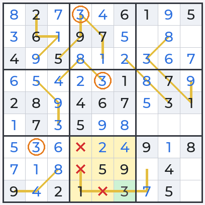

<!-- Written by tools/walkthrough.py dutch-whispers: edit the script, not this page. -->
# Dutch Whispers, step 41: the 3 in box 8

**Step 41 of 52** · [← Step 40](step-40.md) · [All steps](../dutch-whispers.md#the-whole-puzzle-step-by-step) · [Step 42 →](step-42.md)

Box 8 needs a 3. r7c4: row 7 has one (r7c2). r8c4: column 4 has one (r1c4). r9c5: column 5 has one (r4c5). Only **r9c6** is left: **r9c6 = 3**.

**Step 41 of 52** · [← Step 40](step-40.md) · [All steps](../dutch-whispers.md#the-whole-puzzle-step-by-step) · [Step 42 →](step-42.md)
