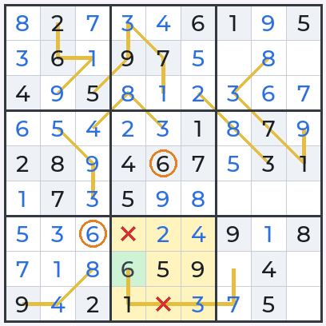

<!-- Written by tools/walkthrough.py dutch-whispers: edit the script, not this page. -->
# Dutch Whispers, step 42: the 6 in box 8

**Step 42 of 52** · [← Step 41](step-41.md) · [All steps](../dutch-whispers.md#the-whole-puzzle-step-by-step) · [Step 43 →](step-43.md)

Box 8 needs a 6. r7c4: row 7 has one (r7c3). r9c5: column 5 has one (r5c5). Only **r8c4** is left: **r8c4 = 6**.

**Step 42 of 52** · [← Step 41](step-41.md) · [All steps](../dutch-whispers.md#the-whole-puzzle-step-by-step) · [Step 43 →](step-43.md)
