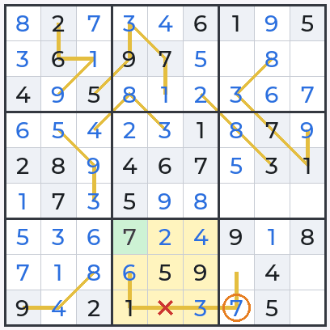

<!-- Written by tools/walkthrough.py dutch-whispers: edit the script, not this page. -->
# Dutch Whispers, step 43: the 7 in box 8

**Step 43 of 52** · [← Step 42](step-42.md) · [All steps](../dutch-whispers.md#the-whole-puzzle-step-by-step) · [Step 44 →](step-44.md)

Box 8 needs a 7. r9c5: row 9 has one (r9c7). Only **r7c4** is left: **r7c4 = 7**.

**Step 43 of 52** · [← Step 42](step-42.md) · [All steps](../dutch-whispers.md#the-whole-puzzle-step-by-step) · [Step 44 →](step-44.md)
